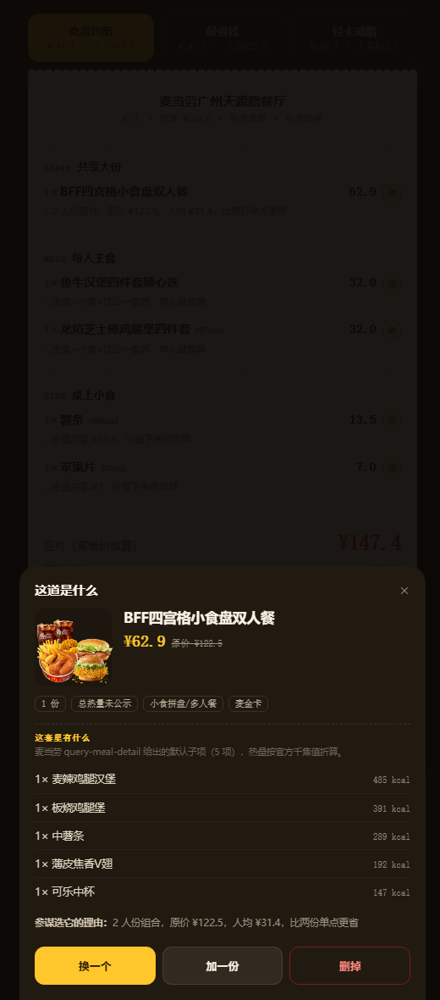

# 开饭参谋 · 报人数、报预算，摆好一桌麦当劳


> 一群人中午吃麦当劳，最烦的不是吃什么，是**人多嘴杂**：有人减脂、有人不吃牛肉、有人不吃辣，还得卡住预算。
> 开饭参谋让你只报三件事 —— **几个人、多少钱、谁忌口** —— 它读麦当劳实时菜单，给出三套可对比的方案，并且**每一单都交给官方算价引擎核过价**才敢报给你。

**它不是点单终端，是团餐参谋。**

<p align="center">
  <a href="https://west-liu.github.io/mcd-kaifan/"></a>
  <a href="https://west-liu.github.io/mcd-kaifan/demo.html"></a>
  <a href="docs/USAGE.md"></a>
</p>

<p align="center">
  
  
</p>
<p align="center">
  <sub>左：三个人、一个预算、每人点忌口 &nbsp;·&nbsp; 右：出方案，每项可点开改，价是官方核过的</sub>
</p>

<p align="center">
  
  
</p>
<p align="center">
  <sub>左：套餐点开看官方子项构成 &nbsp;·&nbsp; 右：切成外送，参数整条链路跟着变</sub>
</p>

---

## 为什么不是又一个点单页

同类作品大多是「点单终端」：把菜单做成卡片流，让用户一件件加购，帮你算省钱。

那类产品解决的是「**我已经知道要吃什么，帮我点得便宜**」。

开饭参谋解决的是「**我根本不知道这一桌该怎么配**」。所以它的输入里必须有 `人数`、`预算`、`每个人的忌口` —— 这三个东西在单人点单场景里根本不存在。

| | 点单终端 | 开饭参谋 |
|---|---|---|
| 输入 | 商品 | 人数 · 预算 · 逐人忌口 |
| 输出 | 购物车 | 三套可对比方案 + 每项推荐理由 |
| 谁来决策 | 用户 | 系统，用户只做取舍 |
| 价格 | 标价 / 优惠 | 官方 `calculate-price` 反向校验，对不上就换 |
| 忌口 | 无 | 全桌硬约束（牛肉/辣/炸物）+ 个人诉求（减脂/去冰/不要酱） |

---

## 三套方案，三种价值观

同一份菜单，同样的预算，给出三种取舍：

| 方案 | 策略 | 适合 |
|---|---|---|
| **吃得均衡** | 主食 + 共享小食 + 饮品 + 甜品，人均最舒服 | 同事聚餐 |
| **最省钱** | 优先双人餐 / 套餐，把人均压到底 | 学生、团建凑数 |
| **轻卡减脂** | 只挑可核实热量的低卡主食 + 0 卡饮品 | 有人在控卡 |

每一套都会：

1. **从官方菜单挑** —— `query-meals`，实测 127 个在售餐品，剔除周边玩具酱包
2. **按人算忌口** —— 硬约束影响全桌，个人诉求只影响那一份
3. **交给麦当劳算价** —— `calculate-price` 拿真实应付价、原价、优惠
4. **核不过就换** —— 单项小计和菜单价对不上（典型：需要选子项的多人分享餐，官方按默认高价计），把该餐品**拉黑重搭**，最多 3 轮，整单对得上才报
5. **算热量** —— `list-nutrition-foods` 158 条；组合餐查不到就 `query-meal-detail` 拆子项累加
6. **告诉你今天店里有什么** —— 活动日历、卡包券、一键领券

---

## 真调 MCP，不是 mock

```
麦当劳 MCP  https://mcp.mcd.cn   Bearer Token
│
├── query-nearby-stores   找门店        ├── calculate-price   官方核价
├── query-meals           拉菜单        ├── available-coupons 卡包券
├── list-nutrition-foods  营养表        ├── campaign-calendar 活动
├── query-meal-detail     拆组合餐      └── create-order      真实下单
│
└→ 搭配引擎（人数 × 预算 × 忌口）→ 三套方案 → 官方核价 → 对小票
```

`/api/health` 就是这么自检的，真实返回：

```json
{"ok":true,"tokenConfigured":true,"toolsAvailable":35,
 "tools":["query-meals","query-nearby-stores","calculate-price",
          "available-coupons","campaign-calendar","list-nutrition-foods","create-order"]}
```

一次真实搭配的收尾（`pricedBy` 就是证据）：

```
吃得均衡  ¥171.8  mcd-calculate-price
最省钱    ¥96.0   mcd-calculate-price
轻卡减脂  ¥138.0  mcd-calculate-price
```

### 两个只有踩过才知道的坑

| 坑 | 现象 | 修法 |
|---|---|---|
| **千焦当大卡** | 营养表字段名叫 `kcal`，实际值是千焦。麦辣鸡腿堡返回 2029，真实 485 kcal。不修正，「轻卡」会推出两千大卡的餐 | `> 1200` 自动除以 4.184，快照统一换算 |
| **组合餐算价对不上** | 分享餐要选子项，传 `roundList` 十种格式全被拒，不传则服务端按默认子项计价，小计虚高 | 不传 `roundList`，服务端算价反向校验，对不上拉黑重搭 |

---

## 快速开始

### 在线版（什么都不用装）

- 作品：**https://west-liu.github.io/mcd-kaifan/**
- 自动演示：**https://west-liu.github.io/mcd-kaifan/demo.html**

单文件 HTML，数据是官方 MCP 快照（浏览器直连 MCP 会被 CORS 拦），算法与实时版同源。

### 实时版 · Docker（一条命令）

```bash
git clone https://github.com/west-liu/mcd-kaifan.git && cd mcd-kaifan
echo "MCD_TOKEN=你的Token" > .env          # open.mcd.cn/mcp 手机号登录领取
docker build -t mcd-kaifan . && docker run -d --name kaifan -p 8080:5173 --env-file .env mcd-kaifan
# 打开 http://localhost:8080
```

### 实时版 · 裸 Node（零依赖，不用 npm install）

```bash
cp .env.example .env    # 只填 MCD_TOKEN
node server.js          # http://localhost:5173
```

Node 18+ 即可，全项目 **0 个第三方依赖**。

---

## 用它

1. 确认门店（支持城市 / 关键词搜）
2. 选人数（1–8）
3. 选预算（或手填）
4. 给每个人点忌口
5. 点「开饭」→ 三套方案切换 → 点任意一行可看构成、换一个、加/删 → 复制清单，或让 MCP 真下单

真实输出长这样（3 人 ¥90，1 号减脂、3 号不吃牛肉）：

```
【开饭参谋】3 人 · 预算 ¥90 · 麦当劳广州天源路餐厅
方案：吃得均衡

SHARE 共享大份
  1× 麦麦周末双人餐          ¥49.9
     ↳ 2 人份组合，原价 ¥85.5，人均 ¥24.9，比两份单点更省
MAIN 每人主食
  1× 酥脆无双套餐            ¥20.0   243kcal
     ↳ 来自低热量专区
SIDE 桌上小食
  1× 蘸酱脆皮鸡块            ¥11.9
  1× 苹果片                  ¥7.0    133kcal

应付（官方核价）  ¥88.8      人均 ¥29.6      结余 ¥1.2
全桌避开：牛肉
```

---

## 项目结构

```
mcd-kaifan/
├── server.js              # HTTP 服务 + 路由 + 算价校验循环 + AI 点评
├── mcp.js                 # MCP 客户端（Streamable HTTP + JSON-RPC，零依赖）
├── lib/
│   ├── mcd.js             # 门店/菜单/营养/算价/券/活动/下单/外送
│   └── planner.js         # 搭配引擎：人数 × 预算 × 忌口 → 三套方案
├── public/                # 实时版前端（H5 单文件）
├── dist/                  # 单文件成品 + 自动演示页
├── docs/USAGE.md          # 使用说明
├── Dockerfile             # node:22-alpine，ENABLE_ORDER 默认关
├── DEPLOY.md              # 四种部署路径 + 自检
└── tools/                 # 构建与截图脚本
```

## HTTP API

| 方法 | 路径 | 说明 |
| --- | --- | --- |
| GET | `/api/health` | MCP 连通性自检，返回可用工具数 |
| GET | `/api/stores?city=广州&keyword=天源路` | 搜索可点餐门店 |
| GET | `/api/addresses` | 外送配送地址 |
| POST | `/api/plan` | 生成方案（`headcount`/`budget`/`prefs`/`way`） |
| GET | `/api/coupons` | 卡包券 |
| POST | `/api/coupons/claim` | 一键领券 |
| GET | `/api/campaigns` | 今日活动 |
| POST | `/api/order` | 真实下单（需 `confirm:true`，`ENABLE_ORDER=0` 时关闭） |

## 文档

- [使用说明](docs/USAGE.md) · [MCP 集成说明](MCP_INTEGRATION.md) · [部署](DEPLOY.md) · [参赛声明](CONTEST_DECLARATION.md) · [开发对话记录](workbuddy.md)

## 说明

- 参赛作品，参赛者独立开发，**非麦当劳官方产品**。
- 餐品、价格、供应状态以麦当劳官方渠道实时结果为准。
- 下单会创建**真实订单**，公网部署请保持 `ENABLE_ORDER=0`。
- 营养数据仅供参考，不构成医疗或营养建议。
