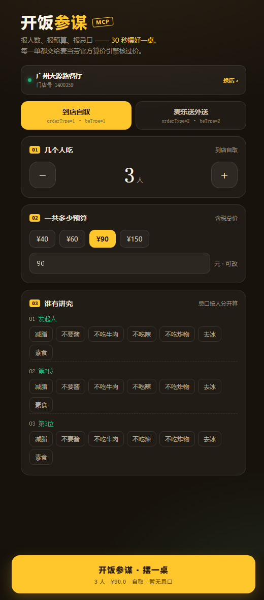
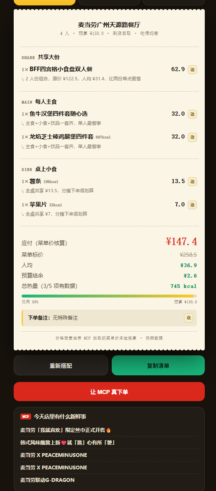
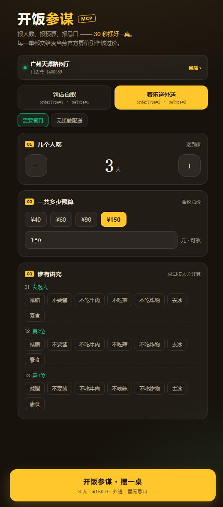

# 开饭参谋 · McDonald's Group-Ordering Copilot

> 报人数、报预算、报忌口，它读麦当劳实时菜单，出三套经**官方算价引擎核过价**的团餐方案，一键真下单。
> Powered by 麦当劳官方 MCP（35 tools）· 零依赖 Node.js · Docker 一条命令自部署


---

## 它解决什么问题

一群人吃麦当劳，最烦的不是吃什么，是**人多嘴杂**：有人减脂、有人不吃牛肉、有人不吃辣，还得卡住预算。打开点单 App，菜单一百多样，没人知道这一桌该怎么配 —— 微信群里接龙半小时，最后预算还超了。

开饭参谋把这件事变成三个数字：

1. **几个人**（1–8，逐人点忌口：减脂 / 不吃牛肉 / 不吃辣 / 去冰……）
2. **多少钱**（总预算，或人均）
3. **点「开饭」**

输出三套可对比方案（吃得均衡 / 最省钱 / 轻卡减脂），每项带推荐理由和热量；每一单都丢回麦当劳 `calculate-price` 官方核价，**核不过就自动换品重搭**，对得上才报给你。确认后可直接创建真实订单，跳官方支付页付款取餐。

**它不是点单终端，是团餐参谋。**

---

## ▶ 在线体验

| 入口 | 链接 | 说明 |
| --- | --- | --- |
| **主链接** | **https://west-liu.github.io/mcd-kaifan/** | 打开即用，无需安装，自动直连实时后端 |
| **备用链接** | **https://kaifan.waymate.vip/** | 同代码同后端；国内访问 GitHub 超时时用 |
| **自动演示** | [demo.html](https://west-liu.github.io/mcd-kaifan/demo.html) | 14 步自动走完，不看说明直接看效果 |
| **使用手册** | 页面右下角「使用手册」按钮 | 上手步骤、口令用法、支付规则 |

**真下单演示口令：`kf-ae182690`**（点「让 MCP 真下单」时粘贴；口令只保护下单，浏览、核价不需要）

**作者的 Token 额度用完了？** 麦当劳 MCP 每日下单额度按 Token（账号）计。点页面上 **「换成我的」**，粘贴你自己的 MCP Token（免费领：[open.mcd.cn/mcp](https://open.mcd.cn/mcp) → 手机号登录 → 控制台 → 激活）即可用你自己的额度继续真下单。Token 只存在你自己设备的浏览器里。

---

## 功能一览

- **团餐搭配引擎**：人数 × 预算 × 逐人忌口 → 三套价值观不同的方案
- **官方反向核价**：候选单回传 `calculate-price` 校验，小计对不上自动拉黑重搭（最多 3 轮）
- **真实下单闭环**：`create-order` → 官方支付 H5 → 15 分钟倒计时 → 自动轮询取餐码
- **BYO Token（多租户）**：访客可带自己的 MCP Token，服务端按 Token 隔离会话与缓存，默认回落到部署者的 Token
- **营养核真**：`list-nutrition-foods` 158 条营养表；组合餐自动 `query-meal-detail` 拆子项累加；千焦/大卡字段错误自动修正
- **门店 / 菜单 / 券 / 活动**：`query-nearby-stores`、`query-meals`（实测 127 个在售餐品）、`available-coupons` 一键领券、`campaign-calendar` 今日活动
- **外送链路**：配送地址 → 可送门店 → beCode，整条参数链自动切换
- **安全开关**：`ENABLE_ORDER=0` 一键关下单、`DEMO_PASS` 口令保护、CORS 白名单、自定义 MCP 地址白名单防 SSRF

---

<p align="center">
  
  
</p>
<p align="center">
  <sub>左：三个人、一个预算、每人点忌口 &nbsp;·&nbsp; 右：出方案，每项可点开改，价是官方核过的</sub>
</p>

<p align="center">
  
  
</p>
<p align="center">
  <sub>左：套餐点开看官方子项构成 &nbsp;·&nbsp; 右：切成外送，参数整条链路跟着变</sub>
</p>

---

## 商用与二次开发

MIT 协议，可自由商用。三种典型用法：

**1. 直接部署成你公司的团餐工具**
Docker 一条命令起服务，填你的 `MCD_TOKEN` 即可。行政 / HR 发一个链接，全公司自己报人数预算忌口，方案出来直接下单。`ENABLE_ORDER=0` 可只当参谋不下单。

**2. 嵌进你现有的 AI Agent / 工作流**
[`mcp.js`](mcp.js) 是一个**零依赖的麦当劳 MCP 客户端**（Streamable HTTP + JSON-RPC，握手 / 会话复用 / SSE 解析 / structuredContent 提取全处理好），[`lib/mcd.js`](lib/mcd.js) 是门店、菜单、营养、核价、券、下单的业务封装 —— 拿去做点单机器人、社群接龙、企业微信应用都可以。MCP 接入配置见 [mcp-config.example.json](mcp-config.example.json)。

**3. 参考它的 BYO Token 模式做你自己的 MCP 多租户服务**
访客请求头带 `x-mcp-token` 就用访客的，不带就用部署者的；`AsyncLocalStorage` 请求级凭据隔离 + 按 Token 分片缓存 —— 这是把单账号 MCP 服务开放给公众体验的最小可行架构，代码即文档。

**不是又一个点单页**：同类产品解决「我知道要吃什么，帮我点便宜」；开饭参谋解决「我根本不知道这一桌该怎么配」。输入里必须有 `人数`、`预算`、`逐人忌口` —— 这三样在单人点单场景里根本不存在。

| | 点单终端 | 开饭参谋 |
|---|---|---|
| 输入 | 商品 | 人数 · 预算 · 逐人忌口 |
| 输出 | 购物车 | 三套可对比方案 + 每项推荐理由 |
| 谁来决策 | 用户 | 系统，用户只做取舍 |
| 价格 | 标价 / 优惠 | 官方 `calculate-price` 反向校验，对不上就换 |
| 忌口 | 无 | 全桌硬约束（牛肉/辣/炸物）+ 个人诉求（减脂/去冰/不要酱） |

---

## 快速开始

### Docker（一条命令）

```bash
git clone https://github.com/west-liu/mcd-kaifan.git && cd mcd-kaifan
echo "MCD_TOKEN=你的Token" > .env          # open.mcd.cn/mcp 手机号登录领取
docker build -t mcd-kaifan . && docker run -d --name kaifan -p 8080:5173 --env-file .env mcd-kaifan
# 打开 http://localhost:8080
```

### 裸 Node（零依赖，不用 npm install）

```bash
cp .env.example .env    # 只填 MCD_TOKEN
node server.js          # http://localhost:5173
```

Node 18+ 即可，全项目 **0 个第三方依赖**。公网部署务必设置 `DEMO_PASS`（下单口令）或 `ENABLE_ORDER=0`。

---

## 三套方案，三种价值观

同一份菜单，同样的预算，给出三种取舍：

| 方案 | 策略 | 适合 |
|---|---|---|
| **吃得均衡** | 主食 + 共享小食 + 饮品 + 甜品，人均最舒服 | 同事聚餐 |
| **最省钱** | 优先双人餐 / 套餐，把人均压到底 | 学生、团建凑数 |
| **轻卡减脂** | 只挑可核实热量的低卡主食 + 0 卡饮品 | 有人在控卡 |

每一套都会：

1. **从官方菜单挑** —— `query-meals`，剔除周边玩具酱包
2. **按人算忌口** —— 硬约束影响全桌，个人诉求只影响那一份
3. **交给麦当劳算价** —— `calculate-price` 拿真实应付价、原价、优惠
4. **核不过就换** —— 单项小计对不上就把该餐品拉黑重搭，整单对得上才报
5. **算热量** —— 组合餐查不到就拆子项累加
6. **告诉你今天店里有什么** —— 活动日历、卡包券、一键领券

---

## 真调 MCP，不是 mock

```
麦当劳 MCP  https://mcp.mcd.cn   Bearer Token
│
├── query-nearby-stores   找门店        ├── calculate-price   官方核价
├── query-meals           拉菜单        ├── available-coupons 卡包券
├── list-nutrition-foods  营养表        ├── campaign-calendar 活动
├── query-meal-detail     拆组合餐      └── create-order      真实下单
│
└→ 搭配引擎（人数 × 预算 × 忌口）→ 三套方案 → 官方核价 → 对小票
```

### 两个只有踩过才知道的坑

| 坑 | 现象 | 修法 |
|---|---|---|
| **千焦当大卡** | 营养表字段名叫 `kcal`，实际值是千焦。麦辣鸡腿堡返回 2029，真实 485 kcal | `> 1200` 自动除以 4.184 |
| **组合餐算价对不上** | 分享餐要选子项，不传则服务端按默认子项计价，小计虚高 | 服务端算价反向校验，对不上拉黑重搭 |

---

## HTTP API

| 方法 | 路径 | 说明 |
| --- | --- | --- |
| GET | `/api/health` | MCP 连通性自检，返回可用工具数与 Token 来源 |
| GET | `/api/stores?city=广州&keyword=天源路` | 搜索可点餐门店 |
| GET | `/api/addresses` | 外送配送地址 |
| POST | `/api/plan` | 生成方案（`headcount`/`budget`/`prefs`/`way`） |
| GET | `/api/coupons` | 卡包券 |
| POST | `/api/coupons/claim` | 一键领券 |
| GET | `/api/campaigns` | 今日活动 |
| POST | `/api/order` | 真实下单（需 `confirm:true`，`ENABLE_ORDER=0` 时关闭） |
| GET | `/api/order/:orderId` | 订单状态 / 取餐码 |

所有接口支持请求头 `x-mcp-token`（访客自带 Token）与 `x-demo-pass`（下单口令）。

## 项目结构

```
mcd-kaifan/
├── server.js              # HTTP 服务 + 路由 + 算价校验循环
├── mcp.js                 # MCP 客户端（Streamable HTTP + JSON-RPC，零依赖）
├── lib/
│   ├── ctx.js             # 请求级凭据上下文（AsyncLocalStorage）
│   ├── mcd.js             # 门店/菜单/营养/算价/券/活动/下单/外送
│   └── planner.js         # 搭配引擎：人数 × 预算 × 忌口 → 三套方案
├── public/                # 实时版前端（H5 单文件）
├── dist/                  # 单文件成品 + 自动演示页
├── Dockerfile             # node:22-alpine
├── DEPLOY.md              # 四种部署路径 + 自检
└── tools/                 # 构建与截图脚本
```

## 文档

- [使用说明](https://west-liu.github.io/mcd-kaifan/usage.html) · [MCP 集成说明](MCP_INTEGRATION.md) · [部署](DEPLOY.md) · [参赛声明](CONTEST_DECLARATION.md) · [开发对话记录](workbuddy.md)

## License

[MIT](LICENSE) —— 可自由商用、修改、再分发，保留版权声明即可。

## 说明

- 参赛/学习作品，作者独立开发，**非麦当劳官方产品**。
- 餐品、价格、供应状态以麦当劳官方渠道实时结果为准。
- 下单会创建**真实订单**，公网部署请保持 `ENABLE_ORDER=0` 或设置 `DEMO_PASS`。
- 营养数据仅供参考，不构成医疗或营养建议。
